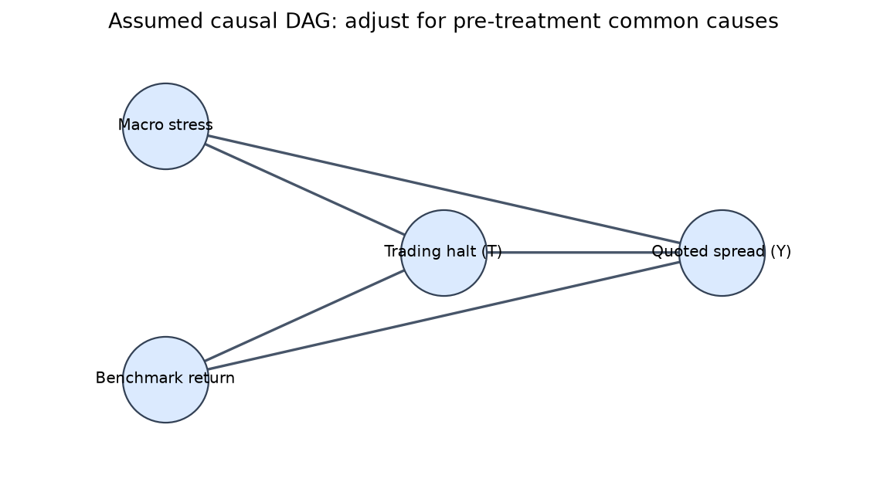
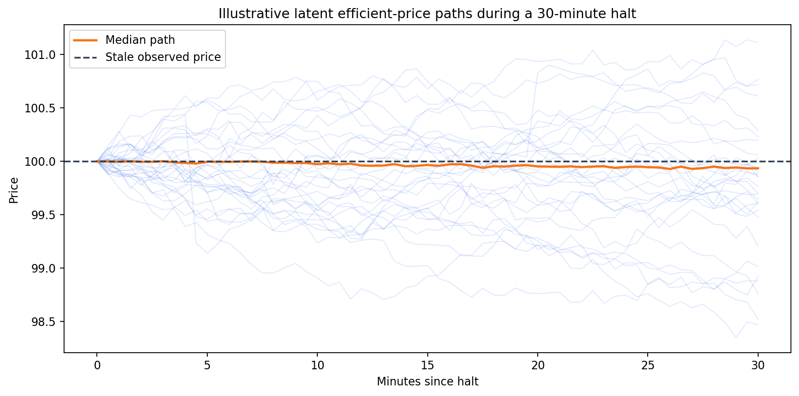
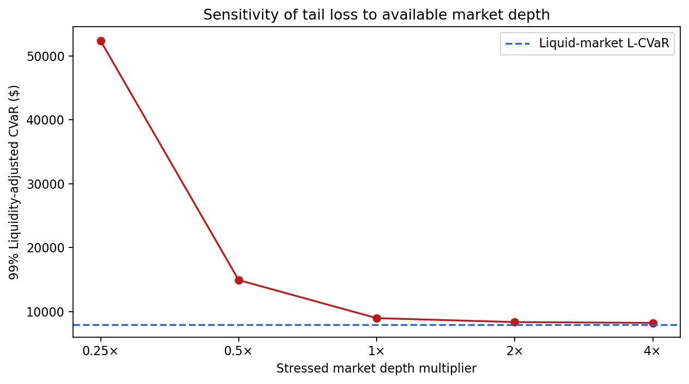
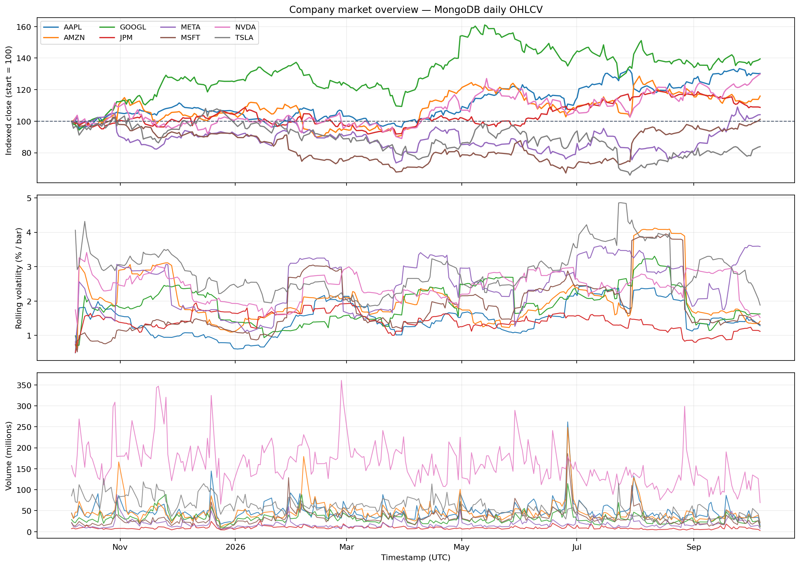

# Structural Friction Modeling: Trading Halts & Liquidity Shocks

## Overview

This repository provides a quantitative research framework for modeling portfolio risk under severe structural market constraints, with a primary focus on sudden trading halts and liquidity vacuums.

In markets prone to structural intervention (e.g., China A-shares, emerging markets, or sudden exchange-level circuit breakers), standard mean-variance and historical VaR models often fail due to stale pricing and forced un-observability. This project utilizes structural causal models (SCM) and stochastic latent-price dynamics to differentiate between temporary, mechanics-driven liquidity shocks and permanent fundamental price degradation.

## Mathematical Methodology

### 1. Latent Price Dynamics & Stale Observation

During a trading halt, the observed market price $P_t$ remains constant, but the unobservable latent efficient price $P^*_t$ continues to evolve based on macroeconomic beta and cross-asset correlations. We model the latent price evolution as a jump-diffusion process:

$$dP^*_t = \mu(X_t) dt + \sigma(X_t) dW_t + J_t dN_t$$

Where:

* $X_t$ represents the vector of observable exogenous confounders (e.g., ETF flows, correlated un-halted assets).
* $W_t$ is a standard Brownian motion.
* $N_t$ is a Poisson process capturing discrete information arrivals (jumps) during the halt.

### 2. Causal Estimation of Halt Impact (do-calculus)

To isolate the purely microstructural penalty of the halt from the fundamental information driving it, we apply Judea Pearl’s *do-calculus*. Let $T \in \{0, 1\}$ be the treatment variable indicating a structural liquidity shock, and $Y$ be the subsequent realized volatility or bid-ask spread expansion post-halt.

We estimate the Average Treatment Effect (ATE) controlling for the confounder set $X$:

$$ATE = \mathbb{E}[Y \mid do(T=1)] - \mathbb{E}[Y \mid do(T=0)]$$

Using the backdoor adjustment criterion, the counterfactual expectation is computed as:

$$\mathbb{E}[Y \mid do(T=t)] = \int \mathbb{E}[Y \mid T=t, X=x] \cdot \mathbb{P}(X=x) dx$$

This isolates the permanent impairment caused by the lack of price discovery, independent of the news that caused the halt.

### 3. Liquidity-Adjusted Expected Shortfall (L-CVaR)

Standard Conditional Value at Risk (CVaR) drastically underestimates tail risk when assets cannot be liquidated. We penalize the portfolio optimization objective by integrating an exogenous liquidity cost function $C(V_t)$, where $V_t$ is the available volume. The Liquidity-Adjusted CVaR at confidence level $\alpha$ is defined as:

$$\text{L-CVaR}_\alpha = \frac{1}{1-\alpha} \int_{0}^{1-\alpha} \left( q_\gamma(L) + \mathbb{E}\left[ C(V_t) \mid L \ge q_\gamma(L) \right] \right) d\gamma$$

Where $q_\gamma(L)$ is the $\gamma$-quantile of the standard portfolio loss distribution, and $C(V_t)$ approaches infinity as structural friction (halts) drives $V_t \to 0$.

## Directory Architecture

```text
.
├── .vscode/               # Editor configurations (Black/Ruff, debugging)
├── data/                  # Raw and processed tick data (Gitignored)
├── notebooks/             # EDA, jump-diffusion modeling, and causal graphing
├── src/                   # Core Python package
│   ├── ingestion/         # MongoDB connection pools and data hydration pipelines
│   ├── causal/            # DoWhy estimators and backdoor adjustment logic
│   └── simulation/        # L-CVaR calculation and liquidity replay engine
├── tests/                 # Pytest suite for stochastic integrators and matrix ops
├── docker-compose.yml     # Local MongoDB container orchestration
└── pyproject.toml         # Dependency and package management via uv
```

## Tech Stack

* Language: Python 3.11+

* Mathematical: SciPy, StatsModels
* Optional causal analysis: DoWhy (`pip install -e ".[causal]"`)
* Optional uplift modeling: CausalML (`pip install -e ".[uplift]"`)

* Data Ops: Pandas, NumPy

* Database: MongoDB (via pymongo)

* Infrastructure: Docker Compose

## Quick Start

1. Environment Setup
Initialize the containerized MongoDB database and install the Python dependencies:

```Bash
docker-compose up -d
uv venv
source .venv/bin/activate
uv pip install -e .
```

If you are using an existing Python/conda environment instead, install the project into the same interpreter that will run it:

```bash
python -m pip install -e .
```

The default install includes the market-data downloader, MongoDB client, charting, and simulation dependencies. DoWhy is available through the optional `causal` extra. CausalML is isolated in the optional `uplift` extra because it compiles native extensions and may require Microsoft C++ Build Tools on Windows.

1. Data Ingestion
Hydrate the local MongoDB instance with sample exchange feeds containing historical halt timestamps:

```Bash
python -m src.ingestion.hydrate_db --source data/raw/sample_ticks.csv --collection equities
```

1. Running the Simulation
Execute the baseline liquidity shock simulation to compute the ATE and L-CVaR against a hypothetical portfolio state:

```bash
python -m src.simulation.run_shock_scenario --portfolio data/portfolios/base.json --confidence-level 0.99
```

1. Market Data Dashboard
The dashboard reads MongoDB by default using `MONGODB_URI` and the optional `MONGODB_DATABASE` (or `MONGODB_DB_NAME`) from the project `.env`. The default database name is `structural_friction_modeling`. It reads bars from `market_bars`, quotes from `market_quotes`, and halts from `halt_events`.

```bash
python main.py --output-dir outputs
```

Without `--symbol`, MongoDB mode compares all available companies in one indexed-price, volatility, and volume dashboard. Add `--symbol AAPL` for the detailed single-company chart. For a local CSV instead, pass `--source csv --input data/raw/market_bars.csv`; an optional halt-events CSV can be supplied with `--halts data/raw/halts.csv`. The dashboard PNG and machine-readable summary JSON are written to `outputs/`.

1. Download research price history
The optional Yahoo Finance helper downloads adjusted daily OHLCV bars for eight liquid U.S. company tickers and idempotently upserts them into the same `.env`-configured MongoDB `market_bars` collection:

```bash
python -m src.yfinance_ingest
python main.py --symbol AAPL --output-dir outputs/AAPL
```

Choose a custom set/history window with `python -m src.yfinance_ingest --tickers AAPL MSFT COST JPM --period 2y`. Yahoo Finance does not supply the project’s quote depth or official halt-event data through this workflow; use a licensed quote/halt source for spread, depth, or causal halt analysis. Yahoo Finance data can be delayed, incomplete, rate-limited, and subject to its terms. Verify data rights and quality for your use case.

Run the end-to-end refresh and dashboard workflow with one command from the repository root:

```bash
python -m src.run_project
```

This fetches and upserts the default company basket, then builds the MongoDB comparison dashboard and JSON summary under `outputs/`. Use `--skip-download` to regenerate the dashboard from stored records without contacting Yahoo Finance.

## Results

The figures and numerical summaries below are generated by the notebooks and the end-to-end runner. The causal and risk notebooks use seeded **synthetic data** to demonstrate methods; only the company overview uses Yahoo Finance daily OHLCV read back from the `.env`-configured MongoDB. None of these outputs should be interpreted as a calibrated halt-impact forecast.

### Causal discovery: assumptions and adjusted estimate



The DAG states the assumptions used in [the causal-discovery notebook](notebooks/01_causal_discovery.ipynb): pre-treatment macro stress and benchmark returns influence both halt probability and quoted spread, so the analysis adjusts for those common causes. It is a specified causal hypothesis, not a graph discovered or proved from the correlations.

In 5,000 seeded synthetic event observations, 13.9% were assigned a halt. The known synthetic spread effect was **$0.0800/share**; the adjusted DoWhy estimate was **$0.0777/share**, while the unadjusted treated/control difference was **$0.0913/share**. In this simulation, adjustment moved the estimate closer to the known effect. This validates the example workflow, not a real-market causal effect. The model assumes the listed covariates suffice to control confounding; actual inference needs defensible, time-aligned pre-halt confounders and event/control observations.

### Latent price uncertainty during a halt



The [friction-estimation notebook](notebooks/02_friction_estimation.ipynb) simulates 1,000 possible efficient-price paths over a 30-minute halt from a $100 last observed price. Its 1st, 5th, median, 95th, and 99th percentile end prices were **$95.48, $98.55, $99.93, $101.07, and $101.89**. The spread between possible paths illustrates why a frozen quote during a halt should not be mistaken for an unchanged efficient value. These percentiles depend entirely on the illustrative drift, volatility, jump, and time-step assumptions.

### Liquidity-adjusted tail risk and depth sensitivity



With the same 20,000 synthetic return scenarios and the notebook's illustrative impact factor, the model reported:

| Scenario | L-VaR | L-CVaR |
| --- | ---: | ---: |
| Liquid-market assumptions | $6,923.38 | $7,957.67 |
| Halt / stressed-liquidity assumptions | $8,023.46 | $8,969.49 |

The modeled stressed-liquidity L-CVaR is **$1,011.83 higher** than the liquid case. In the depth sensitivity chart, reducing stressed depth to 25% causes the model's L-CVaR to rise sharply; increasing depth reduces the modeled penalty. This demonstrates the behavior of the current quadratic cost formula, not observed liquidation losses. The impact factor and inputs have not been calibrated against quote, order-book, or execution data.

### End-to-end company overview from MongoDB



The end-to-end runner read the `market_bars` collection in the configured database and produced 252 adjusted daily OHLCV observations for each of **AAPL, AMZN, GOOGL, JPM, META, MSFT, NVDA, and TSLA**, covering 2025-10-06 through 2026-10-06. The dashboard indexes each price series to 100 at its first observation, and shows per-bar rolling volatility and volume. Over this retrieved window, GOOGL had the largest close-to-close gain (**+39.49%**), while TSLA had the largest decline (**−16.11%**) and the highest mean rolling daily-return volatility (**2.87%**). JPM had the lowest mean rolling volatility (**1.41%**). These are descriptive results for this selected set and period, not a recommendation or a risk-adjusted ranking.

The stored Yahoo Finance collection contains OHLCV, not bid/ask quotes or official halt records. Accordingly, this dashboard reports **zero halt events** and cannot show real spreads, depth, or halt windows. The daily data supports broad price/volume exploration only. The latest generated project summary is [available here](docs/images/project_run/market_summary.json); running `python -m src.run_project --skip-download --output-dir docs/images/project_run` regenerates this dashboard from stored MongoDB data.

## Future Improvements

The results highlight where additional data and validation would make the analysis more decision-useful:

1. **Add official halt-event data.** Ingest venue-published halt/resumption timestamps, reasons, trading status, and auction/resumption details. The current Yahoo Finance dataset has no halt records, so synthetic treatment effects cannot yet be checked against real events.
2. **Collect quotes and executable depth.** Add timestamped bid/ask prices, sizes, and preferably order-book depth plus trade prints around halts and reopenings. This enables observed spread expansion, depth depletion, and slippage analysis rather than treating OHLCV volume as liquidity.
3. **Build comparable controls.** Match non-halted observations by instrument, time of day, venue calendar, volatility regime, sector, and market conditions. Avoid assuming the same clock time on the previous calendar day is automatically a valid counterfactual.
4. **Improve causal identification.** Define confounders using event-time knowledge, measure them strictly before treatment, check overlap/positivity, report uncertainty intervals, and run placebo dates, alternative control windows, and sensitivity analyses for unobserved confounding. Do not control for post-halt outcomes as if they were baseline confounders.
5. **Calibrate and validate liquidity costs.** Estimate the impact function from actual executions or quote/order-book data by asset, venue, order size, and regime. Compare predicted costs and tail losses to held-out periods and stress episodes; report parameter and sampling uncertainty.
6. **Broaden and clean the market panel.** Add more sectors, exchanges, and non-U.S. instruments; preserve currency and corporate-action metadata; audit missing sessions, time zones, delistings, survivorship bias, and vendor revisions.
7. **Use walk-forward monitoring.** Re-estimate with rolling windows, compare regimes, test out-of-sample stability, and track data freshness and ingestion failures so stale or partial bars do not silently drive a risk result.
